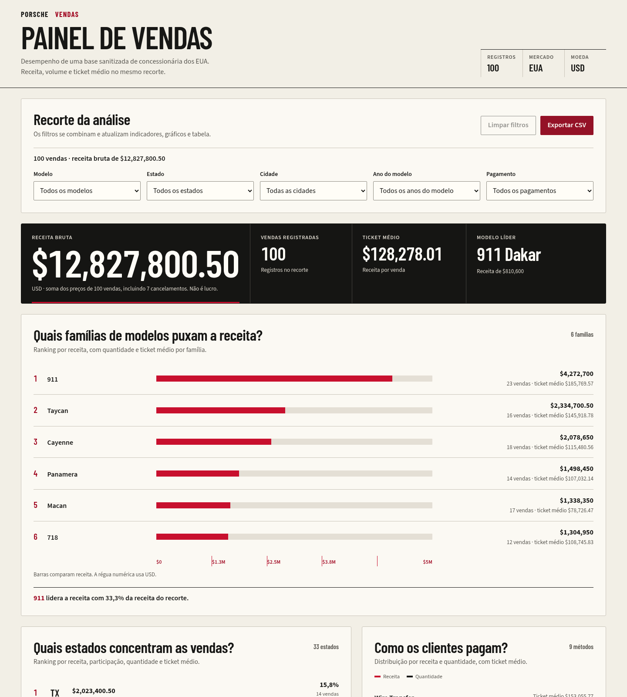
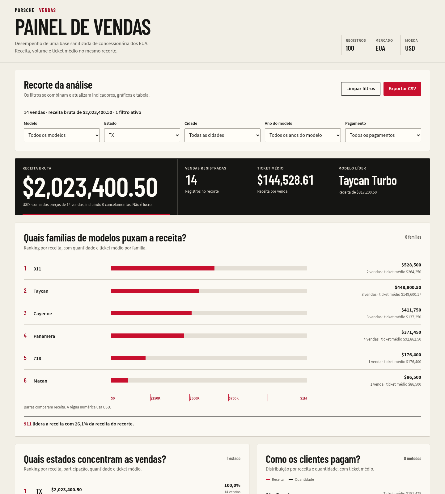
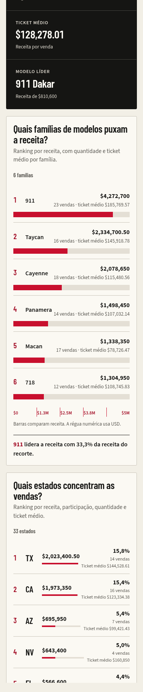
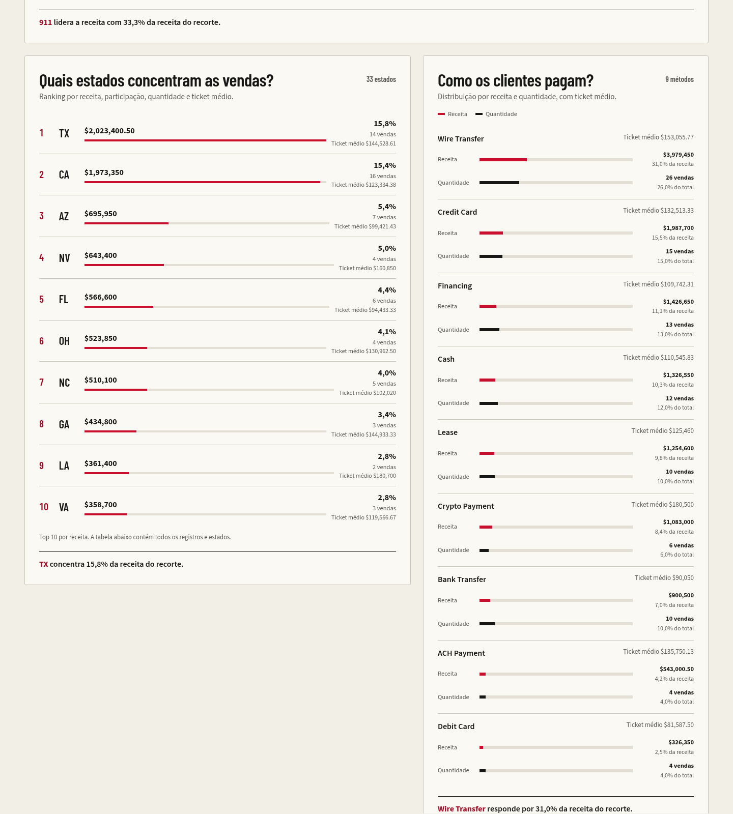

# Porsche Vendas Dashboard

Dashboard interativa em HTML único para analisar 100 vendas sanitizadas da Porsche. O projeto responde a três perguntas de negócio, permite cruzar filtros e mantém uma tabela auditável para conferir cada indicador.

- **Dashboard publicada:** https://shurika6.github.io/porsche-vendas-dashboard/
- **Repositório:** https://github.com/SHURIKA6/porsche-vendas-dashboard
- **Desafio de referência:** [DIO, Criando uma Dashboard da Porsche com Agentes de IA](https://www.dio.me/projects/criando-agentes-de-criacao-de-dashboards-com-excel-e-claude-code)

> Projeto independente de estudo. A base é sanitizada e não representa uma operação oficial da Porsche.

## Perguntas de negócio

### 1. Quais famílias de modelos puxam a receita?

O ranking mostra receita, quantidade e ticket médio por família: 911, Taycan, Cayenne, Panamera, Macan e 718. A base tem 40 modelos distintos e nenhum ultrapassa quatro vendas, então a família dá uma leitura de mix mais útil. O filtro de modelo e o KPI de modelo líder continuam usando o nome exato.

### 2. Quais estados concentram as vendas?

A comparação por estado revela onde a receita está concentrada e quais mercados têm mais volume. A participação percentual ajuda a distinguir concentração real de um ranking com muitos estados pequenos.

### 3. Como os clientes pagam?

A distribuição por forma de pagamento mostra receita, quantidade e ticket médio. Isso permite discutir mix de pagamento sem assumir que o método mais usado é o que mais gera receita.

As três perguntas usam exatamente os mesmos filtros: modelo, estado, cidade, ano e pagamento. O filtro de ano se refere ao ano do modelo, não à data da venda. Assim, qualquer recorte conta a mesma história nos KPIs, gráficos e tabela.

Uma série temporal não foi escolhida porque 24 das 100 datas de venda são inválidas. Outras 18 datas válidas são posteriores à data do projeto e podem representar agendamentos. Usar esse eixo criaria uma falsa sensação de tendência. As perguntas selecionadas aproveitam campos íntegros e respondem a decisões de mix, presença regional e pagamento.

## Leitura rápida da base completa

- Receita bruta: US$ 12.827.800,50. Ticket médio: US$ 128.278,01.
- A família 911 concentra 33,31% da receita em 23 vendas, com ticket de US$ 185.769,57.
- TX e CA somam 30% das vendas e 31,16% da receita. NV se destaca pelo ticket de US$ 160.850,00.
- Wire Transfer concentra 26 vendas e 31,02% da receita.
- 41 vendas têm status `Delivered`. Há sete cancelamentos, totalizando US$ 625.250,00.

Esses números descrevem a amostra do desafio. Com 100 registros e alta fragmentação por modelo e cidade, eles não sustentam projeções amplas.

## Evidências

| Desktop | Filtro aplicado | Mobile |
|---|---|---|
|  |  |  |

### Estados e pagamentos



Exemplo de uso: selecionar um estado no filtro reduz a receita, a quantidade, o ticket médio e os três gráficos. O link compartilhado preserva o recorte pela query string.

[Proveniência e hashes das capturas](docs/PROVENIENCIA.md).

## Como executar

A dashboard não precisa de backend. Basta abrir `index.html` no navegador ou servir a pasta localmente:

```bash
python3 -m http.server 8000
```

Depois acesse `http://localhost:8000`.

Para rodar os testes do tratamento:

```bash
python3 -m unittest discover -s tests -v
```

## Tratamento da base

A planilha original tem 100 registros e 21 colunas, com campos brutos e sanitizados lado a lado. O arquivo bruto contém nomes de clientes e vendedores, por isso não é publicado.

O preparo:

1. Seleciona somente as nove colunas com sufixo `Sanitized`.
2. Converte preço para número decimal.
3. Converte ano e quilometragem para inteiro.
4. Valida as datas ISO e converte `INVALID` em nulo.
5. Normaliza estado para sigla em maiúsculas.
6. Descarta todas as colunas brutas, incluindo nomes.
7. Gera CSV e JSON como valores, sem fórmulas.

Resultado: 100 vendas preparadas e 24 datas inválidas. As datas inválidas não afetam receita, modelo, ano, estado, cidade ou pagamento. Na tabela, elas aparecem como “Data inválida”.

Nesta dashboard, receita bruta significa a soma dos preços de venda sanitizados dos 100 registros, incluindo sete cancelamentos. A base não contém custos, descontos ou margem, então os indicadores não devem ser lidos como lucro.

Arquivos de apoio:

- [Fonte e integridade da planilha](data/FONTE.md)
- [Relatório de tratamento](data/RELATORIO_TRATAMENTO.md)
- [Base sanitizada em CSV](data/vendas_sanitizadas.csv)
- [Base sanitizada em JSON](data/vendas_sanitizadas.json)
- [Script de preparo](scripts/prepare_data.py)
- [Testes do preparo](tests/test_prepare_data.py)

O script usa apenas a biblioteca padrão do Python. Para regenerar a base, baixe a fonte descrita em `data/FONTE.md` para fora do repositório e execute:

```bash
python3 scripts/prepare_data.py --input /caminho/fora-do-repositorio/porsche_database_sanitized.xlsx
```

O XLSX local está ignorado pelo Git para não expor as colunas brutas.

## Publicação

A branch `main` contém o código-fonte, os dados tratados e a documentação. A branch `gh-pages` contém somente o `index.html`, que é a fonte do GitHub Pages. Essa separação evita publicar arquivos de desenvolvimento e mantém a dashboard como um artefato realmente único.

O link público é https://shurika6.github.io/porsche-vendas-dashboard/. O HTML servido foi comparado por SHA-256 com o arquivo local e testado ao vivo.

## Prompt e refinamentos

O briefing inicial pedia três perguntas de negócio, filtros combináveis, KPIs e uma identidade Motorsport premium. A versão final detalhou moeda USD, tabela auditável, exportação CSV, query string, estados de interface, acessibilidade e a restrição de publicar apenas campos sanitizados.

O prompt inicial, o prompt final e cada refinamento estão em [PROMPT.md](PROMPT.md).

## Ferramenta usada

Foi usado um agente de código no OpenCode com as skills `antislop`, `impeccable` e `ui-ux-pro-max`. Subagents localizaram e validaram a fonte, analisaram os dados e implementaram a interface. Não foi usado ChatGPT Canvas nem um agente pago.

A direção visual escolhida foi **Motorsport premium**: off-white, preto e vermelho, tipografia condensada para títulos e sans de leitura para dados. O vermelho é reservado ao destaque e à seleção. Não há imagens, ícones decorativos ou bibliotecas externas de gráficos.

Decisões de design:

- Off-white remete ao ambiente de paddock e reduz o cansaço visual em uma leitura longa.
- Preto organiza a hierarquia e dá peso aos números.
- Vermelho sinaliza apenas líder, seleção e foco, sem competir com os dados.
- Barlow Condensed dá ritmo automotivo aos títulos; Source Sans 3 mantém rótulos e tabela legíveis. As fontes vêm do Google Fonts, com fallbacks locais para manter a função offline.
- A receita é maior que os demais KPIs porque define o tamanho do recorte.
- O painel de famílias é amplo; estados e pagamentos usam uma composição mais densa; a tabela encerra a leitura auditável.
- Movimento fica restrito a feedback de interação e é desligado com `prefers-reduced-motion`.

## Verificações

- 5 testes automatizados do tratamento passando.
- 100 registros e 24 datas inválidas conferidos após o preparo.
- 87 de 87 verificações de navegador passando.
- 15 de 15 verificações no link publicado passando.
- Filtros, KPIs, gráficos, tabela, exportação CSV e limpeza testados no navegador.
- Layout verificado em 1440, 1024, 768 e 375px, sem overflow horizontal.
- Navegação por teclado, foco visível e movimento reduzido verificados.
- axe-core com regras WCAG A/AA sem violações; contraste mínimo de 6,19:1.
- GitHub Pages publicado a partir da branch `gh-pages`, que contém somente o `index.html`. A branch `main` guarda o código-fonte, os dados tratados e a documentação.

O relatório completo está em [QA.md](QA.md).

## Privacidade

Somente os nove campos sanitizados entram no HTML e nos arquivos públicos. Nenhum nome de cliente, vendedor, credencial ou dado sensível foi incluído. A moeda é USD porque a base utiliza estados e cidades dos Estados Unidos.
